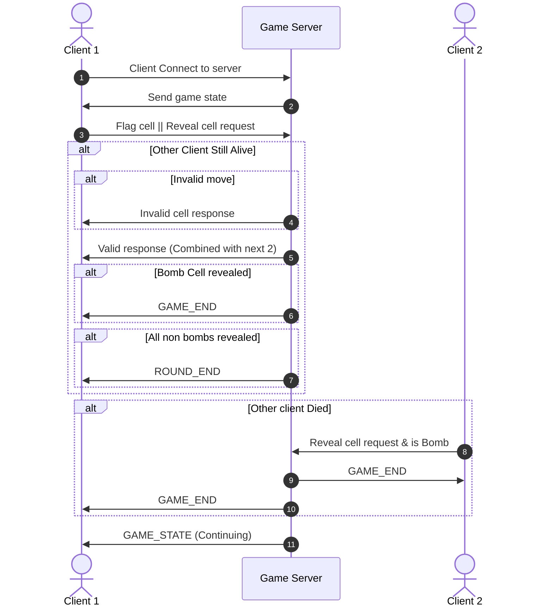
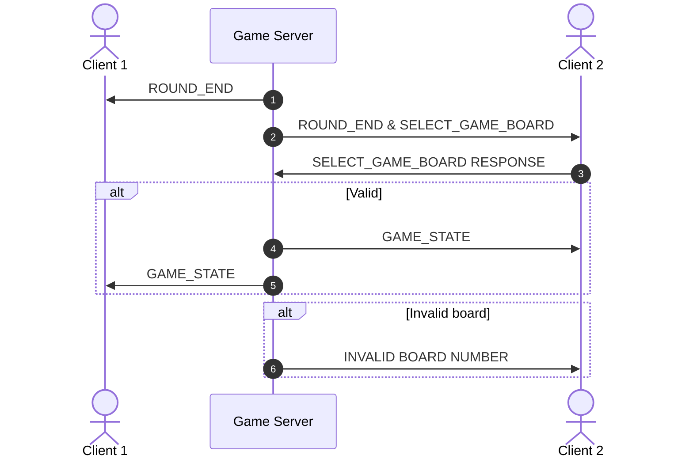
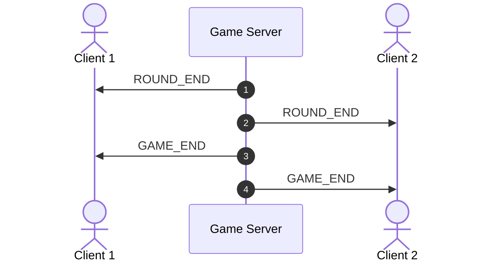

# Client model
3 loops until GAME_END or ROUND_END

Only for the state of the other client hitting a bomb does the next action depend on the other client, until you get to round ending
# Select Sequence
Other client state does matter here as this is when they have it interact dependent on each other

# All rounds completed
